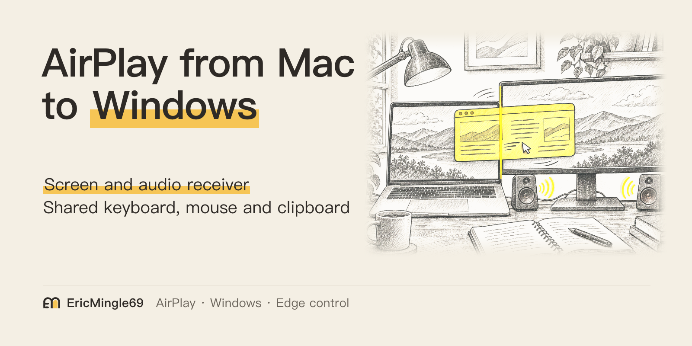

<picture>
  <source media="(prefers-color-scheme: dark)" srcset="readme-assets/cover-en-dark.png">
  
</picture>

<p align="center">
  <a href="https://github.com/Ming-Sir-69/Fucairserver/releases">Download preview</a> ·
  <a href="docs/USER_GUIDE.md">User guide (Chinese)</a> ·
  <a href="docs/BUILDING.md">Build and release</a> ·
  <a href="docs/COMPATIBILITY.md">Compatibility</a> ·
  <a href="https://github.com/Ming-Sir-69">Author</a>
</p>

<p align="center">
  <a href="LICENSE"></a>
  
  
  
  <a href="https://github.com/Ming-Sir-69/Fucairserver/actions/workflows/windows.yml"></a>
</p>

<p align="center">
  <a href="README.md">简体中文</a> · <b>English</b>
</p>

# Fucairserver · AirPlay reception and Mac edge control on Windows

This project provides a native Windows x64 AirPlay video and audio receiver with Mac mirroring and extended desktop, video recording, receiver-name settings and a system tray. Its receiver core is built from pinned revisions of AirPlay-Windows, UxPlay-related implementations and this repository's patch<sup>[[1]](#references)[[2]](#references)</sup>. The current main branch also includes Mac-to-PC edge control for keyboard, mouse, text focus and clipboard sharing.

## Features

- **AirPlay reception**: video and audio from Mac, iPhone and iPad, with Mac mirroring or extended desktop.
- **Local recording and tray operation**: record decoded video as MP4; configure the receiver name, resolution, window and recording directory; keep receiving in the tray after the window closes or minimizes.
- **Edge control (current main branch)**: push the Mac pointer across a screen edge to operate the PC with the Mac keyboard and mouse, with configurable key mappings, bidirectional text focus and clipboard sharing.
- **Mac audio helper (current main branch)**: an optional macOS background agent restores the previous audio output after mirroring starts, so the Mac does not remain switched to the receiver.
- **Experimental component**: a Miracast host uses Windows Wireless Display, MediaPlayer and Composition APIs; reception from a real sender has not been accepted.

Release boundary: the Releases page currently provides **0.2.3 Preview**, while `VERSION` on the main branch is **0.2.9**. Edge control, the Mac audio helper and later interface changes landed after 0.2.3; their presence in the source branch does not imply that the 0.2.3 installer contains them.

## Quick start

Download `Fucairserver-version-windows-x64-setup.exe` and `SHA256SUMS.txt` from [Releases](https://github.com/Ming-Sir-69/Fucairserver/releases). The public preview targets Windows x64. Windows 11 is the current desktop acceptance scope; Windows 10 22H2 (19045) remains a target awaiting equivalent desktop acceptance.

```powershell
Get-FileHash .\Fucairserver-0.2.3-windows-x64-setup.exe -Algorithm SHA256
Get-Content .\SHA256SUMS.txt
```

Compare the setup hash with its entry in the checksum file before running the installer. Installation and firewall changes require administrator approval; normal reception runs as the current user. Connect the sender and PC to the same trusted LAN, then select Fucairserver in the sender's screen-mirroring list. The preview also includes a portable ZIP, product source, corresponding runtime-library source and a CycloneDX SBOM.

The preview may lack an identity-validated publisher signature. A checksum verifies file integrity but does not replace a publisher certificate. Do not disable Windows security protections to install it. Run the new installer to update; receiver names, settings, pairing identity and recordings are preserved by default.

## Usage

- Settings cover interface language, appearance, receiver name, resolution and recording directory. The sound page controls local playback, volume and mute.
- The default recording directory is the current user's `Videos\Fucairserver`; settings and pairing identity are stored in `%APPDATA%\Fucairserver`.
- The Mac edge client on the current main branch requires a separate source installation. From the repository root:

```sh
cd mac/fucair-edge
./install.sh
```

The installer compiles and signs FucairEdge, then installs it as a login item for the current user. macOS requires Accessibility, Input Monitoring and Local Network permissions. During pairing, confirm that the Mac and PC show the same 6-digit code. The edge service uses TCP 7021 and pauses automatically while the Mac mirrors its screen to this PC.

- To install the optional Mac audio helper:

```sh
cd mac/keep-mac-audio
./install.sh "receiver name"
```

Replace `receiver name` with the actual AirPlay name. Run `./install.sh --uninstall` from the same directory to remove it. See the [user guide](docs/USER_GUIDE.md) (Chinese) for edge control, the audio helper and detailed troubleshooting.

## Design

### AirPlay reception

The build restores three upstream source trees at pinned commits and applies this repository's product patch to AirPlay-Windows<sup>[[1]](#references)[[2]](#references)[[3]](#references)</sup>. The receiver advertises AirPlay over LAN mDNS and listens for RTSP on port 7010 by default; it rebroadcasts the LAN IPv4 address after network changes. The media path retains the upstream protocol, decryption, decoding and rendering implementations. The product layer adds persistent settings, recording, a Chinese interface, tray behavior and installer lifecycle.

macOS mirroring requires the receiver to advertise audio support during activation, so audio capability remains advertised even when local playback is muted. Public packages use the MSYS2 UCRT64 FFmpeg 9.0.2-1 build; third-party licenses and corresponding-source locks are recorded separately<sup>[[4]](#references)</sup>.

### Mac edge control

The Mac discovers `_fucair-edge._tcp` through Bonjour. Initial pairing uses X25519 key agreement, random nonces and HMAC-SHA256 confirmation, and requires the user to compare a 6-digit code on both computers. Sessions use AES-GCM. Windows protects the stored pairing key with DPAPI; the Mac key file is readable and writable only by the current user<sup>[[5]](#references)[[6]](#references)[[7]](#references)</sup>.

After the pointer crosses the configured edge, the Mac sends relative movement, key, text and clipboard messages, and Windows injects input through `SendInput`. Clipboard content marked private by a password manager is not synchronized. The lock screen, UAC secure desktop and elevated windows do not accept this injected input.

### Reproducible builds and public packages

The toolchain lock pins **147** MSYS2 UCRT64 packages. The runtime-source lock pins **76** source archives and their SHA-256 hashes. The packager checks normal and delayed PE imports, x64 architecture, and original AirServer filenames, binary hashes and code-section hashes. It collects only required runtime libraries and writes a CycloneDX 1.6 SBOM<sup>[[8]](#references)</sup>. Public builds exclude the workstation's private icon. Release assets include product source, corresponding runtime source and a SHA-256 manifest.

## Limitations

- **Desktop acceptance of 0.2.3 Preview covers Windows 11 x64.** Windows 10 22H2 x64 has not undergone equivalent desktop acceptance. Windows Server CI does not replace tests on real Windows 10/11 desktops, Wi-Fi drivers and sender devices.
- The current preview is unsigned by an identity-validated publisher certificate. Before a stable release, installation cancellation, UAC cancellation, standard-user sessions, offline installation, high DPI, multiple monitors, sleep/resume and network changes still require checks.
- Miracast reception from a real sender is unverified; Google Cast and multi-sender tiled display are incomplete.
- The services are intended for a trusted LAN, not as an Internet relay. Network isolation, guest Wi-Fi, VPN routes and wireless-driver power management can affect discovery or connections.
- Edge input cannot operate the lock screen, UAC or elevated windows. Current main-branch features and published binaries differ by version; consult the notes for the installed release.

## Development

See [Build and release](docs/BUILDING.md) for the complete environment, signing and publication requirements. The build requires Windows x64, PowerShell 7.4+, Git, Node.js 22+, the official MSYS2 base and Inno Setup. Do not mix MSVC, MINGW64 or 32-bit packages with the UCRT64 lock.

```powershell
$env:FUCAIRSERVER_MSYS_ROOT = 'C:\msys64'
pwsh -NoProfile -File scripts/Initialize-Build.ps1 -InstallPackages -IncludeMiracast -IncludeInstaller
pwsh -NoProfile -File scripts/Build.ps1 -PublicBuild
pwsh -NoProfile -File scripts/Build-Miracast.ps1 -PublicBuild
. scripts/Set-BuildEnvironment.ps1
& "$env:FUCAIRSERVER_MSYS_ROOT\ucrt64\bin\ctest.exe" --test-dir build/native-public --output-on-failure
node scripts/Package.mjs dist/packages/release-candidate --public
pwsh -NoProfile -File scripts/Build-Installer.ps1 -PayloadDir "$PWD\dist\packages\release-candidate"
pwsh -NoProfile -File scripts/Get-SourceArchives.ps1
```

The installer lifecycle test installs and uninstalls an isolated app. Run it only on a clean test machine:

```powershell
pwsh -NoProfile -File scripts/Test-Installer.ps1 -Installer path\to\setup.exe
```

CI builds and runs regression tests on Windows Server 2025, then accepts installation, repair while running and uninstallation on Windows Server 2022/2025. A tag must match `VERSION`; a Preview Release is created only after every gate passes. Never bypass a dependency hash or signature failure. Certificates, private keys and passwords must remain outside the repository.

## Acknowledgements

The cover illustration was generated with an OpenAI image-generation model and processed by this project.

This project is based on AirPlay-Windows and uses UxPlay-related protocol implementations, Dear ImGui, FFmpeg and MSYS2 runtime libraries<sup>[[1]](#references)[[2]](#references)[[3]](#references)[[4]](#references)</sup>. The Miracast component refers to the MIT-licensed MiracastReceiverSample. See the [third-party notices](THIRD_PARTY_NOTICES.md) and [Miracast notices](src/miracast/THIRD_PARTY_NOTICES.md) for complete copyrights, licenses and sources.

This project is not affiliated with AirServer or Apple and is not recovered AirServer source code.

## References

1. AirPlay-Windows contributors. *AirPlay-Windows*, revision `f739810e35887cf572b69275a52dc6f32323d65d`. GPL-3.0. <https://github.com/moieric11/AirPlay-Windows/tree/f739810e35887cf572b69275a52dc6f32323d65d>
2. FDH2 and UxPlay contributors. *UxPlay*, revision `a3c064d9111c67a3fc35d5d1e7fbced8712f649a`. GPL-3.0. <https://github.com/FDH2/UxPlay/tree/a3c064d9111c67a3fc35d5d1e7fbced8712f649a>
3. ocornut and Dear ImGui contributors. *Dear ImGui*, revision `f401021d5a5d56fe2304056c391e78f81c8d4b8f`. MIT. <https://github.com/ocornut/imgui/tree/f401021d5a5d56fe2304056c391e78f81c8d4b8f>
4. MSYS2. *mingw-w64-ffmpeg 9.0.2-1 source package*. <https://repo.msys2.org/mingw/sources/mingw-w64-ffmpeg-9.0.2-1.src.tar.zst>
5. Microsoft. *CryptProtectData function, Windows DPAPI*. <https://learn.microsoft.com/en-us/windows/win32/api/dpapi/nf-dpapi-cryptprotectdata>
6. OpenSSL. *EVP_PKEY_derive — public key algorithm shared secret derivation*. <https://docs.openssl.org/3.6/man3/EVP_PKEY_derive/>
7. Apple. *CryptoKit*. <https://developer.apple.com/documentation/cryptokit>
8. CycloneDX. *CycloneDX Specification, version 1.6*. <https://cyclonedx.org/docs/1.6/json/>

## Repository structure

| Path | Contents |
|---|---|
| `src/` | Windows product adaptations, edge control, interface, tests and experimental Miracast host |
| `scripts/patches/native-receiver.patch` | Product patch applied to the pinned AirPlay-Windows revision |
| `scripts/` | Source retrieval, build, test, packaging, signing and release scripts |
| `profiles/` | Locks for upstream revisions, toolchain, runtime source and forbidden binary hashes |
| `mac/` | FucairEdge client and Mac audio helper |
| `installer/` | Inno Setup installer definition |
| `docs/` | Usage, build, compatibility and release notes |
| `readme-assets/` | Light/dark README covers and signature assets |

---

Maintained by <picture><source media="(prefers-color-scheme: dark)" srcset="readme-assets/em-logo-dark.svg"></picture> <b>EricMingle69</b> · <a href="https://github.com/Ming-Sir-69">Ming-Sir-69</a><br>
This project is released under [GPL-3.0-only](LICENSE). Third-party components retain their copyrights and licenses; binary distribution must include corresponding source and notices.
