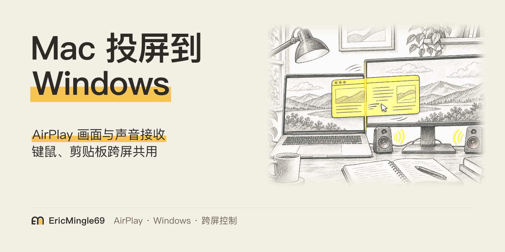

<picture>
  <source media="(prefers-color-scheme: dark)" srcset="readme-assets/cover-zh-dark.png">
  
</picture>

<p align="center">
  <a href="https://github.com/Ming-Sir-69/Fucairserver/releases">下载预览版</a> ·
  <a href="docs/USER_GUIDE.md">使用说明</a> ·
  <a href="docs/BUILDING.md">构建与发布</a> ·
  <a href="docs/COMPATIBILITY.md">兼容性</a> ·
  <a href="https://github.com/Ming-Sir-69">作者主页</a>
</p>

<p align="center">
  <a href="LICENSE"></a>
  
  
  
  <a href="https://github.com/Ming-Sir-69/Fucairserver/actions/workflows/windows.yml"></a>
</p>

<p align="center">
  <b>简体中文</b> · <a href="README.en.md">English</a>
</p>

# Fucairserver · Windows 上的 AirPlay 接收与 Mac 跨屏控制

本项目提供 Windows x64 原生 AirPlay 画面与音频接收器，支持 Mac 镜像和扩展桌面、视频录制、设备名称设置与系统托盘。接收核心由固定版本的 AirPlay-Windows、UxPlay 相关实现和本仓库补丁构建<sup>[[1]](#参考文献)[[2]](#参考文献)</sup>；当前主干还包含 Mac 到 PC 的跨屏键鼠、文字焦点和剪贴板共享。

## 主要功能

- **AirPlay 接收**：接收 Mac、iPhone 和 iPad 的画面与声音；Mac 可选择镜像或扩展桌面。
- **本地录制与常驻**：将解码后的视频录制为 MP4，自定义接收名称、分辨率、窗口和录制目录；关闭或最小化窗口后可留在托盘继续接收。
- **跨屏控制（当前主干）**：Mac 指针越过屏幕边缘后，由 Mac 键盘和鼠标操作 PC，可配置键位映射、双向文字焦点与剪贴板共享。
- **Mac 音频辅助（当前主干）**：可选的 macOS 后台程序在投屏开始后恢复原音频输出，避免 Mac 的声音被自动切走。
- **实验组件**：Miracast 主机使用 Windows 无线显示、MediaPlayer 和 Composition API；真实发送端收流尚未验收。

发布边界：发布页当前提供 **0.2.3 Preview**；主干 `VERSION` 为 **0.2.9**。跨屏键鼠、Mac 音频辅助及后续界面改动位于 0.2.3 之后的主干，不能据此推断 0.2.3 安装包已包含这些能力。

## 快速开始

在 [Releases](https://github.com/Ming-Sir-69/Fucairserver/releases) 下载 `Fucairserver-版本-windows-x64-setup.exe`，同时下载 `SHA256SUMS.txt`。当前公开预览版面向 Windows x64；Windows 11 是现有桌面验收范围，Windows 10 22H2（19045）仍是待实机验收的目标。

```powershell
Get-FileHash .\Fucairserver-0.2.3-windows-x64-setup.exe -Algorithm SHA256
Get-Content .\SHA256SUMS.txt
```

核对安装包对应的 SHA-256 后运行安装器。安装和防火墙变更需要管理员授权，正常接收以当前用户身份运行。让发送设备与 PC 连接同一受信任的局域网，在发送端的屏幕镜像列表选择 Fucairserver。便携 ZIP、产品源码、运行库对应源码和 CycloneDX SBOM 也随预览版提供。

预览版可能没有经身份验证的发布者签名。哈希用于核对文件完整性，不能替代发布者证书；不要为安装而关闭 Windows 安全防护。更新时运行新安装包，设备名称、设置、配对身份和录制文件默认保留。

## 用法

- 在设置中选择界面语言、外观、接收名称、分辨率和录制目录；声音页可调整本机播放、音量与静音。
- 默认录制目录为当前用户的“视频\Fucairserver”，设置与配对身份位于 `%APPDATA%\Fucairserver`。
- 当前主干的 Mac 跨屏端需要单独从源码安装。在仓库根目录执行：

```sh
cd mac/fucair-edge
./install.sh
```

安装脚本编译并签名 FucairEdge，将其安装为当前用户的登录项。macOS 需要授予“辅助功能”“输入监控”和本地网络权限。配对时核对 Mac 与 PC 上相同的 6 位代码；跨屏服务使用 TCP 7021。Mac 向这台 PC 镜像屏幕时，跨屏控制自动暂停。

- 可选的 Mac 音频辅助程序安装命令：

```sh
cd mac/keep-mac-audio
./install.sh "接收器名称"
```

将 `接收器名称` 替换为实际 AirPlay 名称。卸载时在同一目录运行 `./install.sh --uninstall`。跨屏、音频辅助与详细故障排查见 [使用说明](docs/USER_GUIDE.md)。

## 设计与原理

### AirPlay 接收

构建脚本恢复 3 个固定提交的上游源码树，并将本仓库的产品补丁应用到 AirPlay-Windows<sup>[[1]](#参考文献)[[2]](#参考文献)[[3]](#参考文献)</sup>。接收器通过局域网 mDNS 发布 AirPlay 服务，默认 RTSP 监听端口为 7010；网络地址变化后重新广播局域网 IPv4。音视频链路沿用上游的协议、解密、解码与渲染实现，产品层增加持久设置、录制、中文界面、托盘和安装生命周期。

macOS 镜像激活需要接收端声明音频能力，因此即使本机播放被静音，接收器仍声明音频支持。公开包使用 MSYS2 UCRT64 的 FFmpeg 9.0.2-1，第三方许可和对应源码锁保持独立记录<sup>[[4]](#参考文献)</sup>。

### Mac 跨屏控制

Mac 端通过 Bonjour 发现 `_fucair-edge._tcp` 服务。初始配对采用 X25519 密钥交换、随机数与 HMAC-SHA256 确认，并要求用户在两端核对 6 位代码；会话使用 AES-GCM 加密。Windows 侧用 DPAPI 保护保存的配对密钥，Mac 侧密钥文件权限设为仅当前用户可读写<sup>[[5]](#参考文献)[[6]](#参考文献)[[7]](#参考文献)</sup>。

指针跨过约定边缘后，Mac 发送相对移动、按键、文字和剪贴板消息，Windows 通过 `SendInput` 注入输入。密码管理器标记为私密的剪贴板内容不同步。锁屏、UAC 安全桌面和以管理员身份运行的窗口不接受这种输入。

### 可复现构建与公开包

工具链锁固定 **147 个** MSYS2 UCRT64 包，运行库源码锁固定 **76 个**源码归档及 SHA-256。打包器检查普通与延迟 PE 导入、x64 架构、原 AirServer 文件名及二进制和代码段哈希，只收集所需运行库，并生成 CycloneDX 1.6 SBOM<sup>[[8]](#参考文献)</sup>。公开构建排除本机私人图标；发行物同时携带产品源码、运行库对应源码和 SHA-256 清单。

## 局限

- **0.2.3 Preview 的桌面验收范围是 Windows 11 x64。** Windows 10 22H2 x64 尚未完成同等桌面验收；Windows Server CI 不能替代真实 Windows 10/11、无线网卡和发送设备测试。
- 当前预览版未经身份验证的发布者证书签名。稳定版发布前还需完成安装取消、UAC 取消、标准用户、离线安装、高 DPI、多显示器、休眠恢复和网络切换等检查。
- Miracast 真实发送端收流尚未验收；Google Cast 和多发送端并排显示尚未完成。
- 服务面向受信任的局域网，不是互联网中继。网络隔离、访客 Wi-Fi、VPN 路由和无线驱动节能可能影响发现或连接。
- 跨屏输入不能操作锁屏、UAC 或提升权限的窗口。当前主干功能与已发布二进制存在版本差，使用安装包时应以对应发布说明为准。

## 开发

完整环境、签名与发布要求见 [构建与发布](docs/BUILDING.md)。需要 Windows x64、PowerShell 7.4+、Git、Node.js 22+、官方 MSYS2 和 Inno Setup；UCRT64 锁不能混用 MSVC、MINGW64 或 32 位包。

```powershell
$env:FUCAIRSERVER_MSYS_ROOT = 'C:\msys64'
pwsh -NoProfile -File scripts/Initialize-Build.ps1 -InstallPackages -IncludeMiracast -IncludeInstaller
pwsh -NoProfile -File scripts/Build.ps1 -PublicBuild
pwsh -NoProfile -File scripts/Build-Miracast.ps1 -PublicBuild
. scripts/Set-BuildEnvironment.ps1
& "$env:FUCAIRSERVER_MSYS_ROOT\ucrt64\bin\ctest.exe" --test-dir build/native-public --output-on-failure
node scripts/Package.mjs dist/packages/release-candidate --public
pwsh -NoProfile -File scripts/Build-Installer.ps1 -PayloadDir "$PWD\dist\packages\release-candidate"
pwsh -NoProfile -File scripts/Get-SourceArchives.ps1
```

安装器生命周期测试会实际安装和卸载隔离应用，只在干净测试机运行：

```powershell
pwsh -NoProfile -File scripts/Test-Installer.ps1 -Installer path\to\setup.exe
```

CI 在 Windows Server 2025 构建并执行回归测试，再在 Windows Server 2022/2025 验收安装、运行中修复和卸载。标签必须与 `VERSION` 一致，全部门禁通过后才创建 Preview Release。不得绕过依赖哈希或签名失败；证书、私钥与密码不得进入仓库。

## 致谢

封面插画由 OpenAI 图像生成模型生成，经本项目处理。

本项目基于 AirPlay-Windows，并使用 UxPlay 相关协议实现、Dear ImGui、FFmpeg 与 MSYS2 运行库<sup>[[1]](#参考文献)[[2]](#参考文献)[[3]](#参考文献)[[4]](#参考文献)</sup>。Miracast 组件参考 MIT 许可的 MiracastReceiverSample。完整版权、许可和来源见 [第三方通知](THIRD_PARTY_NOTICES.md) 与 [Miracast 通知](src/miracast/THIRD_PARTY_NOTICES.md)。

本项目不隶属于 AirServer 或 Apple，也不是恢复出的 AirServer 源码。

## 参考文献

1. AirPlay-Windows contributors. *AirPlay-Windows*, revision `f739810e35887cf572b69275a52dc6f32323d65d`. GPL-3.0. <https://github.com/moieric11/AirPlay-Windows/tree/f739810e35887cf572b69275a52dc6f32323d65d>
2. FDH2 and UxPlay contributors. *UxPlay*, revision `a3c064d9111c67a3fc35d5d1e7fbced8712f649a`. GPL-3.0. <https://github.com/FDH2/UxPlay/tree/a3c064d9111c67a3fc35d5d1e7fbced8712f649a>
3. ocornut and Dear ImGui contributors. *Dear ImGui*, revision `f401021d5a5d56fe2304056c391e78f81c8d4b8f`. MIT. <https://github.com/ocornut/imgui/tree/f401021d5a5d56fe2304056c391e78f81c8d4b8f>
4. MSYS2. *mingw-w64-ffmpeg 9.0.2-1 source package*. <https://repo.msys2.org/mingw/sources/mingw-w64-ffmpeg-9.0.2-1.src.tar.zst>
5. Microsoft. *CryptProtectData function, Windows DPAPI*. <https://learn.microsoft.com/en-us/windows/win32/api/dpapi/nf-dpapi-cryptprotectdata>
6. OpenSSL. *EVP_PKEY_derive — public key algorithm shared secret derivation*. <https://docs.openssl.org/3.6/man3/EVP_PKEY_derive/>
7. Apple. *CryptoKit*. <https://developer.apple.com/documentation/cryptokit>
8. CycloneDX. *CycloneDX Specification, version 1.6*. <https://cyclonedx.org/docs/1.6/json/>

## 仓库结构

| 位置 | 内容 |
|---|---|
| `src/` | Windows 产品适配、跨屏控制、界面、测试与实验 Miracast 主机 |
| `scripts/patches/native-receiver.patch` | 应用于固定 AirPlay-Windows 提交的产品补丁 |
| `scripts/` | 获取源码、构建、测试、打包、签名与发布脚本 |
| `profiles/` | 上游提交、工具链、运行库源码及禁用二进制哈希锁 |
| `mac/` | FucairEdge 跨屏端与 Mac 音频辅助程序 |
| `installer/` | Inno Setup 安装器定义 |
| `docs/` | 使用、构建、兼容性与发布说明 |
| `readme-assets/` | README 亮暗封面与署名资源 |

---

文档维护：<picture><source media="(prefers-color-scheme: dark)" srcset="readme-assets/em-logo-dark.svg"></picture> <b>EricMingle69</b> · <a href="https://github.com/Ming-Sir-69">Ming-Sir-69</a><br>
本项目以 [GPL-3.0-only](LICENSE) 发布；第三方组件保留各自版权与许可，分发二进制时须同时提供对应源码与通知。
